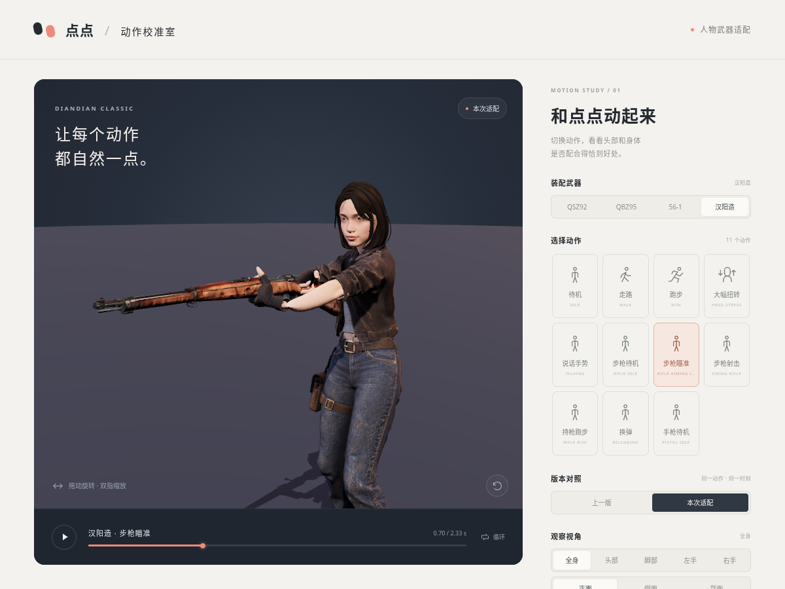
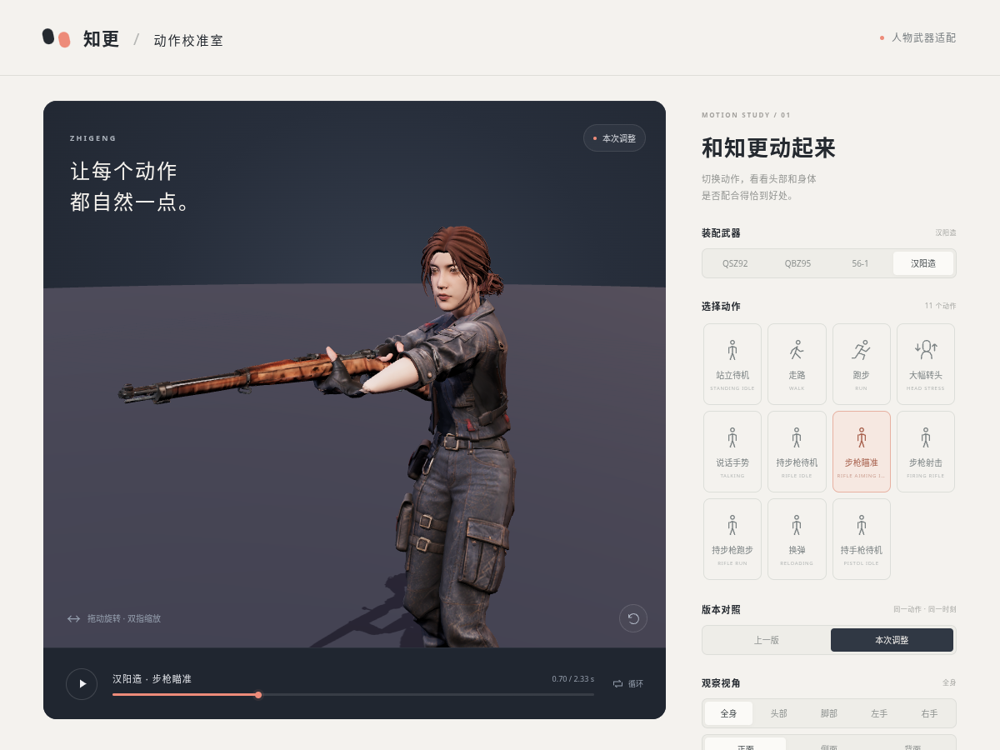

# 汉阳造备选步枪动作（归档）

来源：用户上传 Human Soldier Animations FREE，作者 Kevin Iglesias，包内女性 Rifle 动作组。

| 人物动作 | 源动作 | 预览按钮 |
| --- | --- | --- |
| HanyangAim | HumanF@Rifle_Aim01 | 持步枪待机、步枪瞄准 |
| HanyangFire | HumanF@Rifle_Aim01_Shoot01 | 步枪射击 |
| HanyangReload | HumanF@Rifle_Reload01 | 换弹 |

`diandian_rifle.glb` 和 `zhigeng_rifle.glb` 保留为备选动画库。当前 Godot 与网页预览已按最新要求切回原通用步枪动作组，此库不再自动加载。

重定向脚本：`tools/blender/retarget_soldier_rifle.py`。源文件使用 B-* 骨架，经骨名、解剖朝向、胸椎和手掌轴适配后，烘焙到现有 Mixamo 骨架，保留人物模型、蒙皮与面部绑定。

动画来源授权见原包 Standard Asset Store EULA。仓库保存游戏角色适配结果，不包含原始商店压缩包及 FBX。

瞄准、射击时左手四指向包内 ObjectGripHands01 的抓握手型轻混合 35%，保留自然托枪姿态。重建时将三段 Rifle FBX 与 `Human@ObjectGripHands01.fbx` 提取到同一源目录。

| 点点 | 知更 |
| --- | --- |
|  |  |
