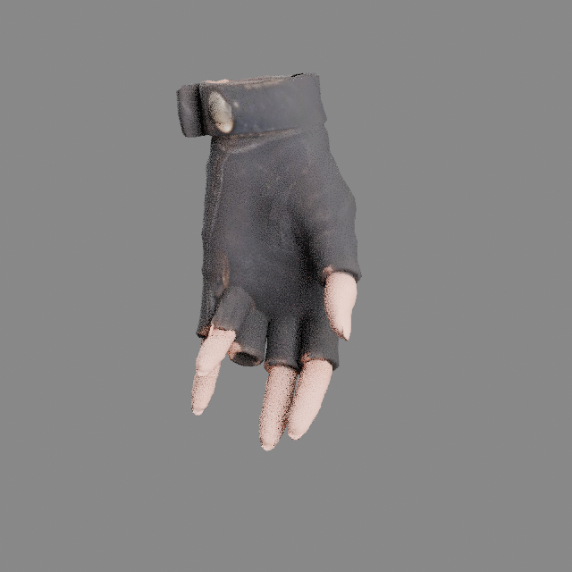
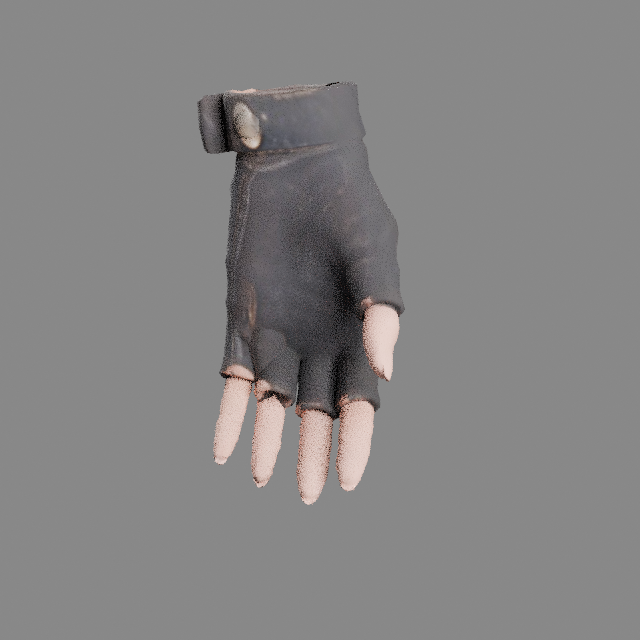
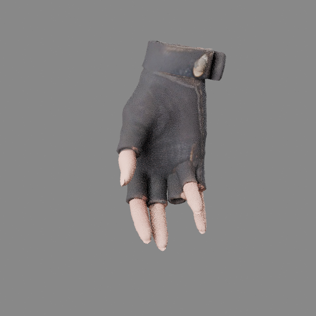
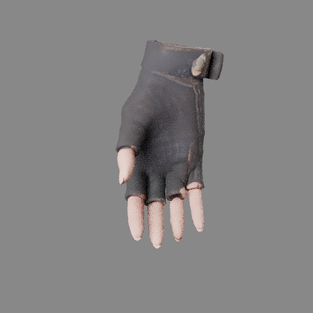
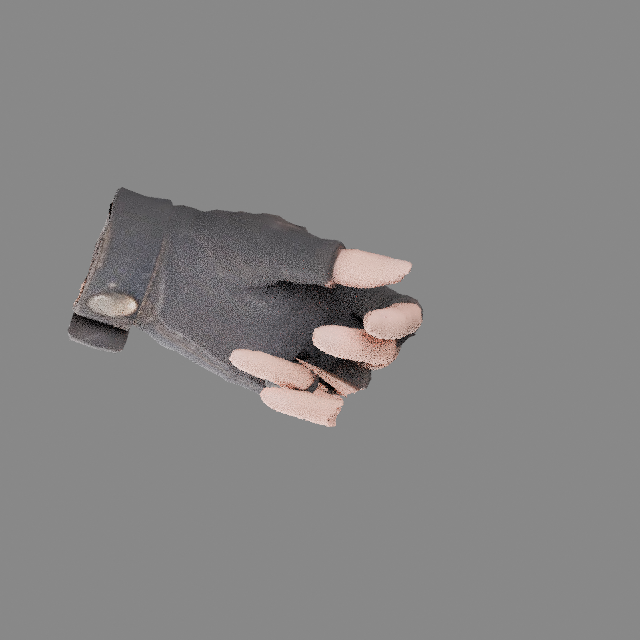
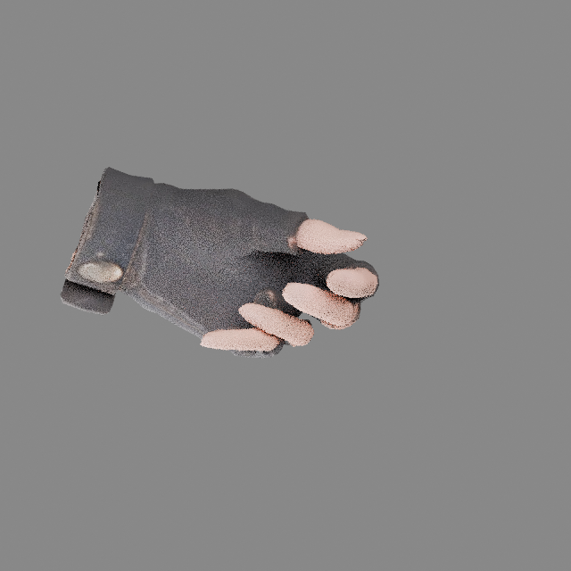
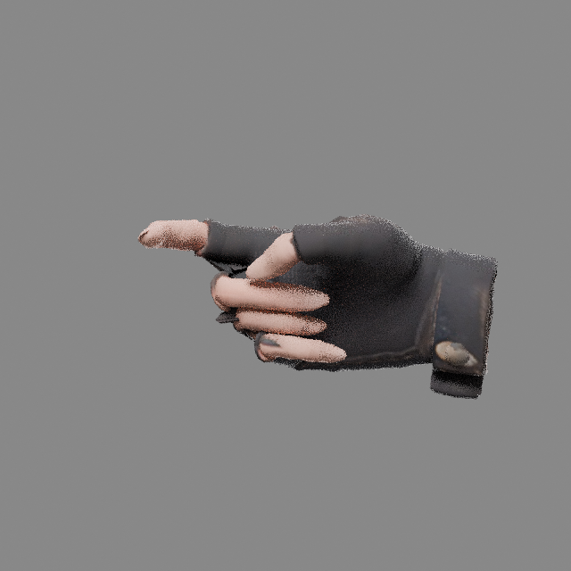
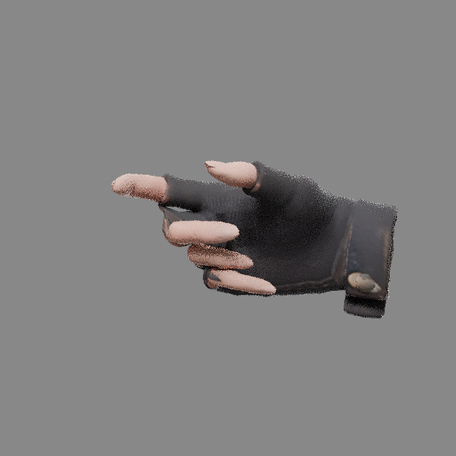

# 点点双手绑定修订 4

本次同时修正左右手。原模型中部分手指权重跨到相邻手指，左无名指骨链偏离实际指形；拇指、食指和小指的裸指尖又与手套属于独立网格，导致两部分跟随不同指骨，运动时出现扭曲、薄片和断口。

重新拟合左无名指骨链，重建双手连续蒙皮，并用袖口接触约束统一独立指尖与对应指套的运动。13 段动作中的指节按父骨方向重新适配，减小过度屈曲和轴向拧转；待机、走路及转头测试中的无名指自然展开。

人物几何、UV、手部之外的蒙皮、身体与手腕动作保持原数据。仍为 312 根骨骼、13 段动作。

| 姿态 | 修正前 | 修正后 |
| --- | --- | --- |
| 左手待机 |  |  |
| 右手待机 |  |  |
| 左手步枪握持 |  |  |
| 右手步枪握持 |  |  |

近景覆盖待机、步枪握持、手枪握持和持枪跑步。动作适配覆盖全部 13 段；蒙皮与袖口接合采用代表帧检查。最终关键姿态中，袖口接触对相较原始位置增加的最大间距小于 0.031 mm。持枪指缝仍保留手套折面。

- [在线预览](https://diandian-classic-motion-lab.expert-eagle-6942.chatgpt.site)
- [下载完整 GLB](https://github.com/752960522qq-ai/diandian/raw/refs/heads/main/assets/characters/diandian_classic/diandian_classic_fixed.glb?download=1)
- [下载 Blender 源文件](https://github.com/752960522qq-ai/diandian/raw/refs/heads/main/assets/characters/diandian_classic/diandian_classic_fixed.blend?download=1)

技术记录见 `hands_revision4_report.json`。网页贴图经过压缩，几何、骨架、蒙皮与动作和完整 GLB 相同。
