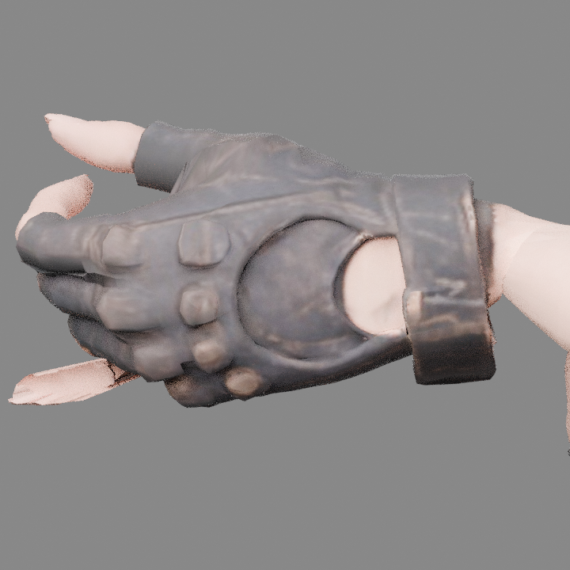
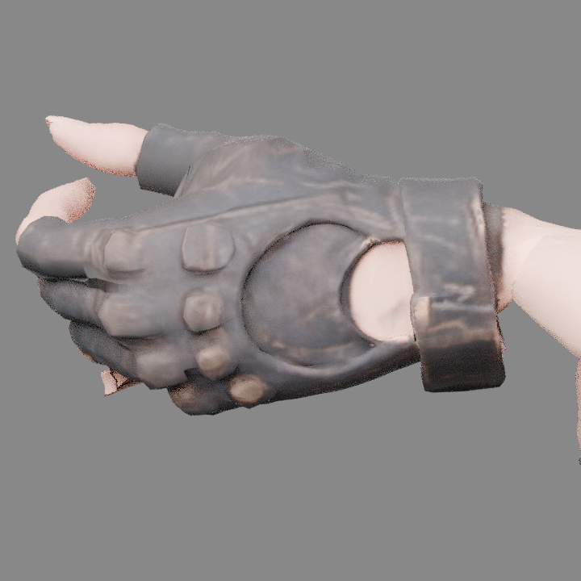

# 点点左手无名指蒙皮修复

异常来自无名指尖部分皮肤被错误归到 LeftHand 手腕，握枪时未跟随指骨转动，形成长薄片。此前单独校准指骨角度无法影响这些顶点。

本次按实际裸指区域定位，将无名指尖及手套边缘的1046个局部顶点重新分配到正确指节，并用渐变过渡和同位置 UV 接缝同步避免拉裂。人物几何、骨架和全部动作曲线保留，其他手指、右手及掌腕主体保持原数据。

已查看射击、手枪待机与原放松待机的实际蒙皮近景。当前完整 GLB、Blender 文件及测试网站均已包含此修复。

| 修复前 | 修复后 |
| --- | --- |
|  |  |

详细记录见 `left_hand_report.json`。
