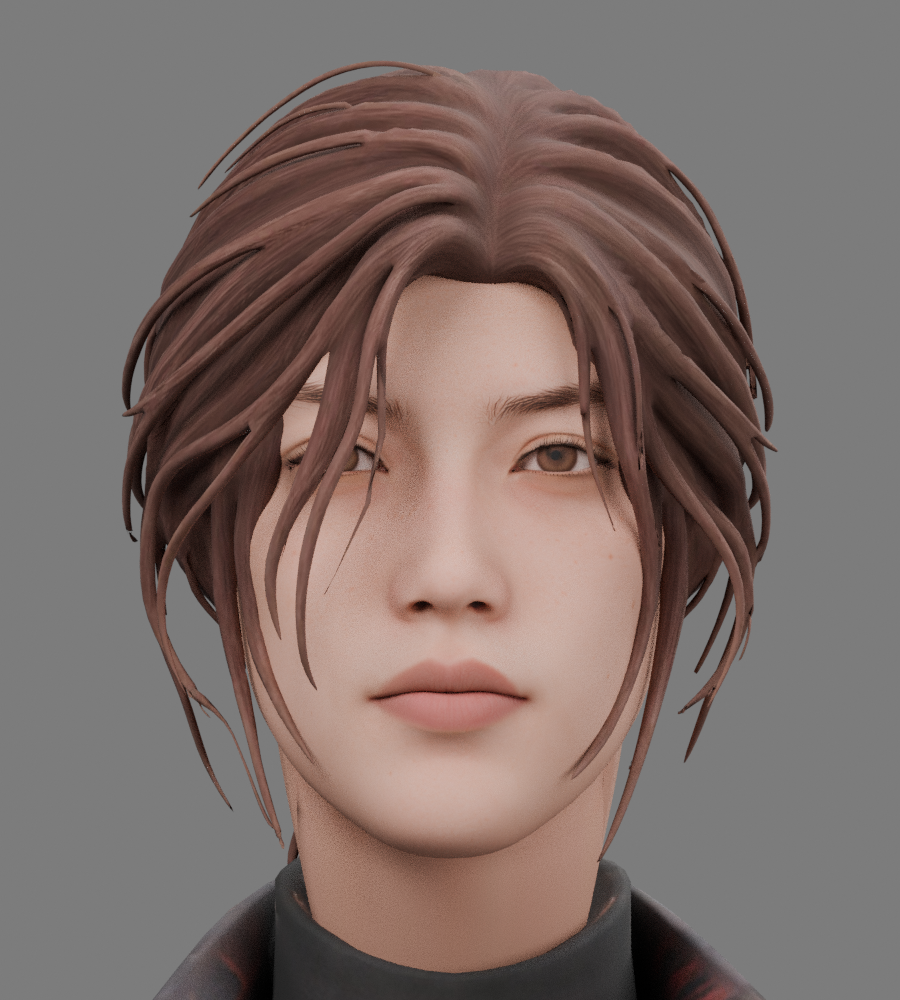
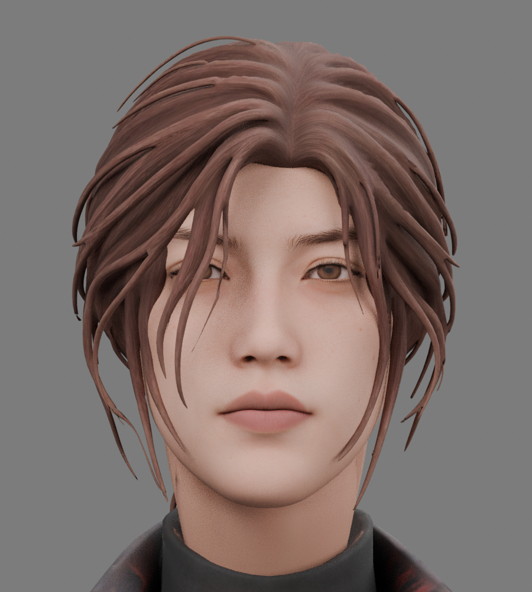
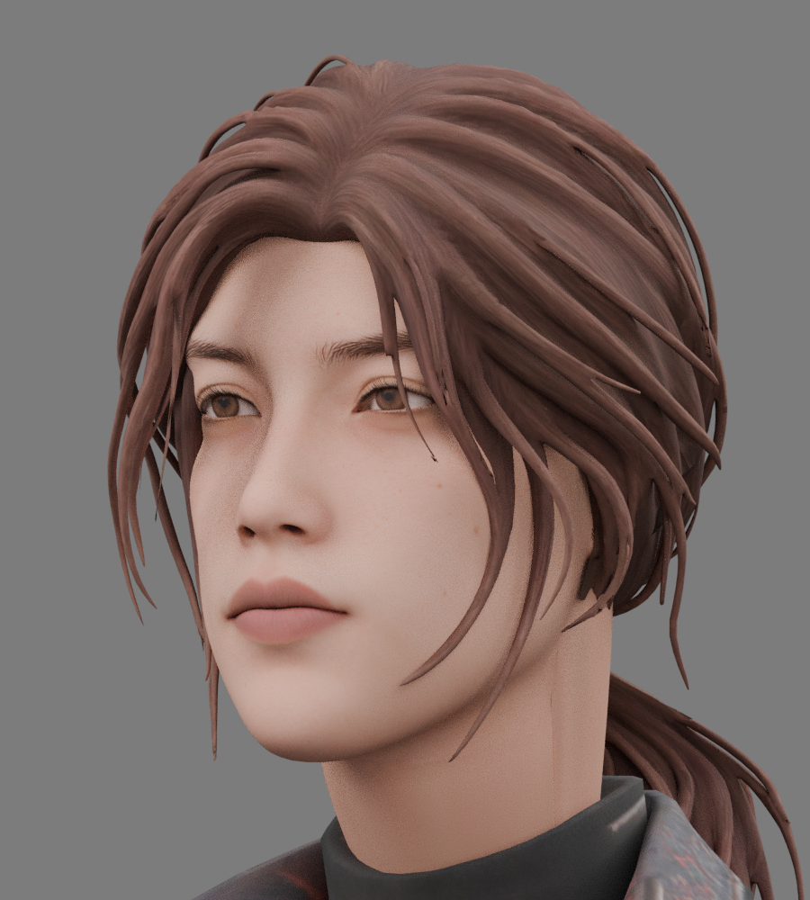

# 知更 · 概念图脸部微调 v4

本版脸部微调已整合到当前角色和测试网站。下方独立 v4 文件保留当时四段动作；当前完整动作包请使用 `zhigeng_character_animated.glb`。

相比概念图，上一版的眼睛开合更圆、眉峰稍挑，下唇更饱满且偏浅粉，颧骨下方的过渡偏柔。概念图的神态更沉稳，唇色更接近低饱和的灰棕玫瑰色。

这次轻收上眼睑、略压平眉峰、减轻下唇的鼓起，并轻收颧骨下方的体积；肤色和唇色通过柔和的顶点色调整，原有皮肤纹理与雀斑保留。整体头部比例、鼻型和眼距沿用原模型。概念图大头像带仰视角度，因此没有按该透视效果放大下颌或修改鼻宽。

## 下载

- [微调版 GLB（含角色、绑定和四段动作）](https://github.com/752960522qq-ai/diandian/raw/refs/heads/main/assets/characters/zhigeng/zhigeng_concept_face_v4.glb?download=1)
- [可编辑 Blender 文件](https://github.com/752960522qq-ai/diandian/raw/refs/heads/main/assets/characters/zhigeng/zhigeng_concept_face_v4.blend?download=1)

## 前后对照

同一静止姿态、同一机位、同一灯光。左为调整前，右为微调后。

| 正面 · 调整前 | 正面 · 微调后 |
| --- | --- |
|  |  |

| 偏侧面 · 调整前 | 偏侧面 · 微调后 |
| --- | --- |
|  |  |

315 根骨骼与四段动作（Idle、Walk、Run、HeadStress）均保留。面部关节随局部形状调整，身体、头发和马尾物理配置沿用上一版。GLB 含原始贴图和用于微调肤色的 COLOR_0；导入时需保留顶点色。

本次是脸部微调，发型的粗发束质感、发色和概念图中的细碎发仍有差别。
