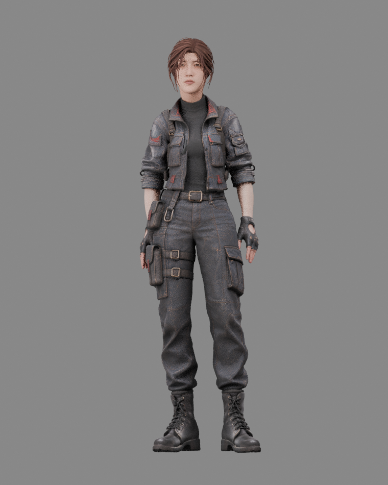
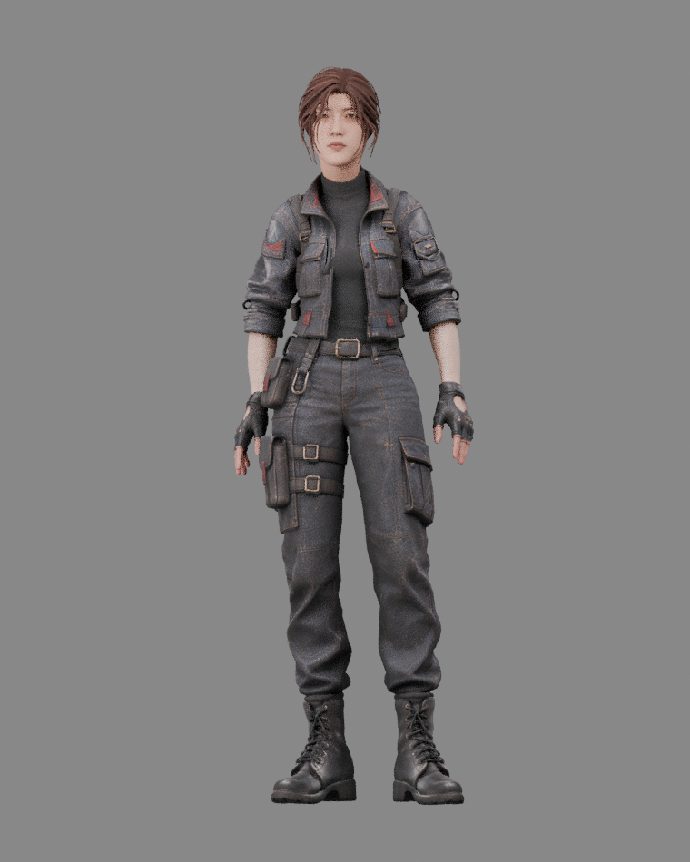
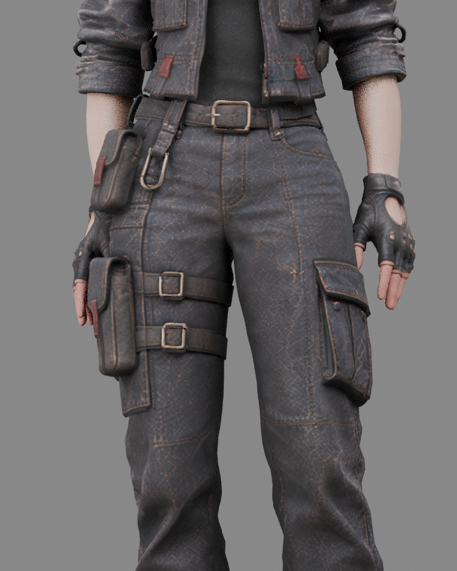
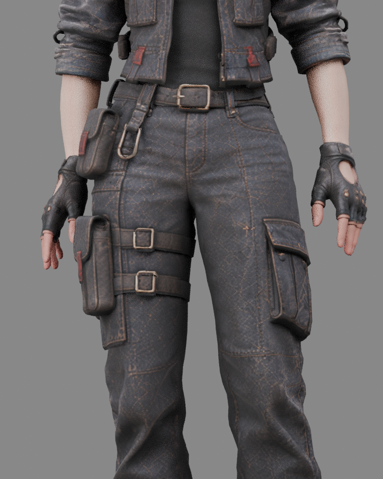

# 知更站立待机手部间距

默认待机仍使用 woman_Standing Idle。双大臂沿躯干前后轴各轻微外展 3.5°，给手套和裤腿、侧袋留出间距。手指、手腕与身体原动作保留，未修改人物几何或骨架。

按整个6秒循环的181帧实际手套顶点与裤腿、侧袋表面检查，未发现手部穿入；记录见 `idle_clearance_revision3.json`。

| 调整前 | 调整后 |
| --- | --- |
|  |  |
|  |  |
