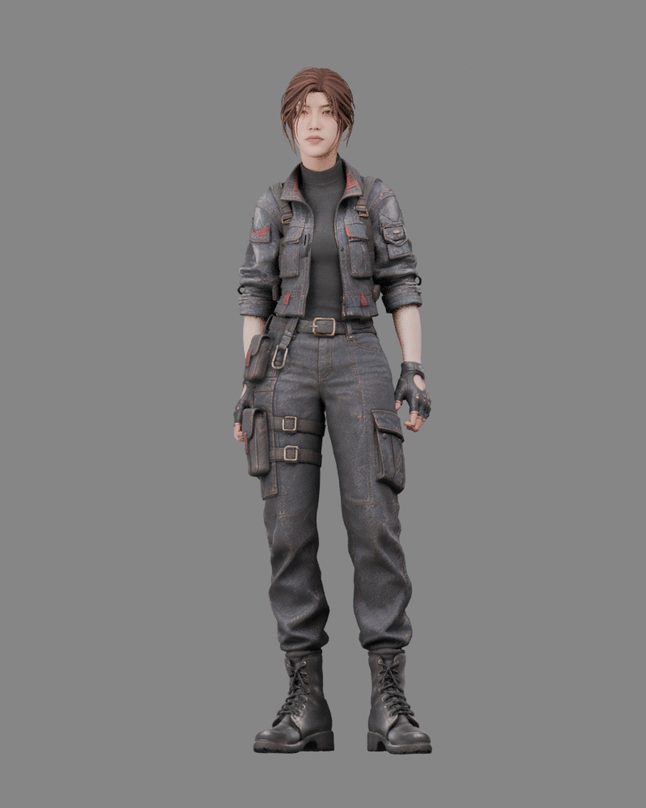
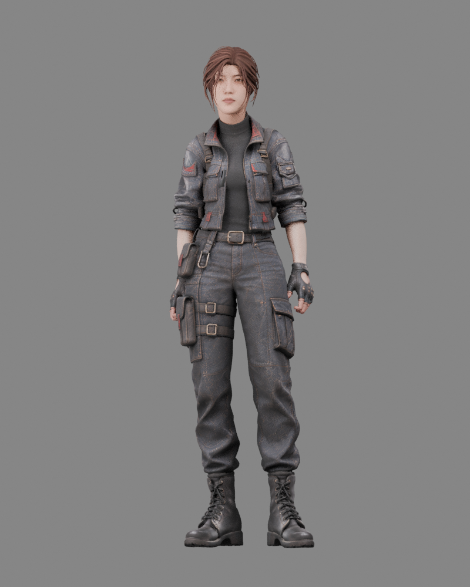
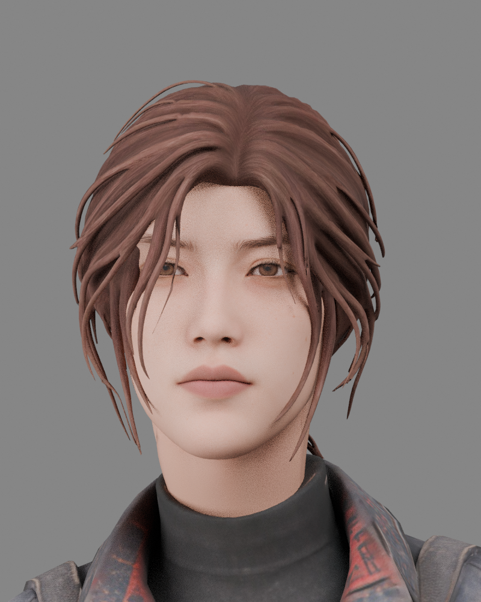
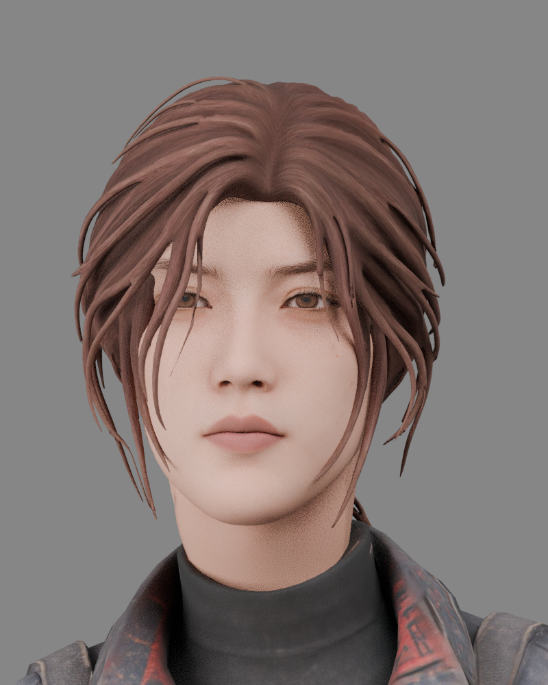
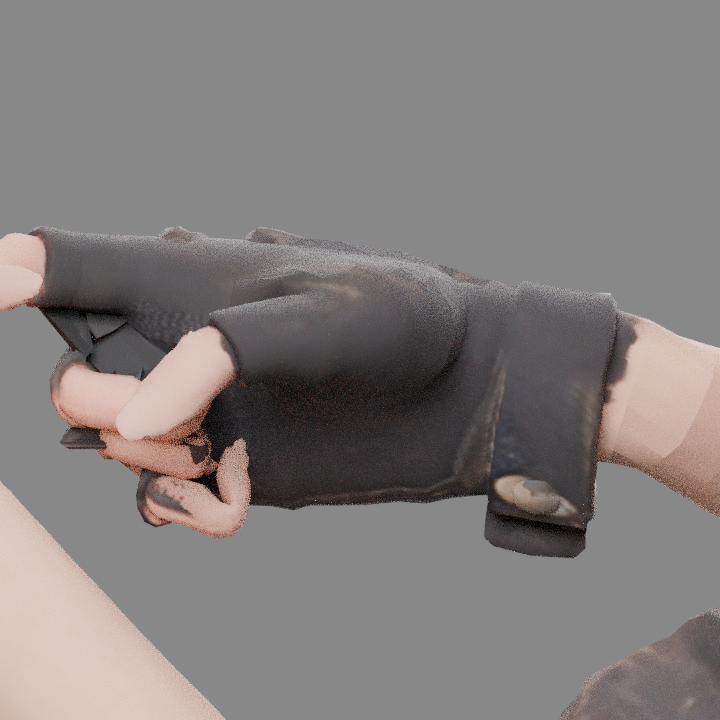
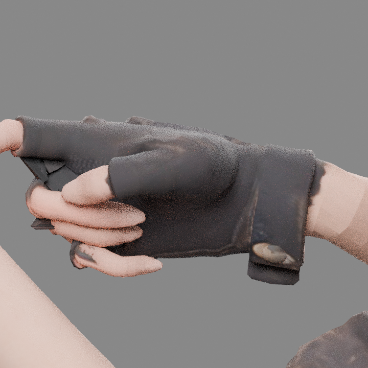
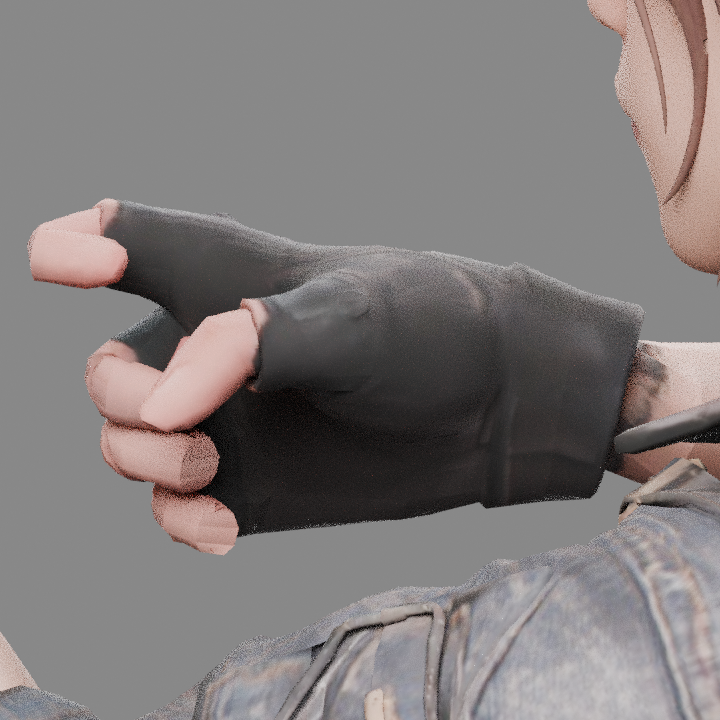
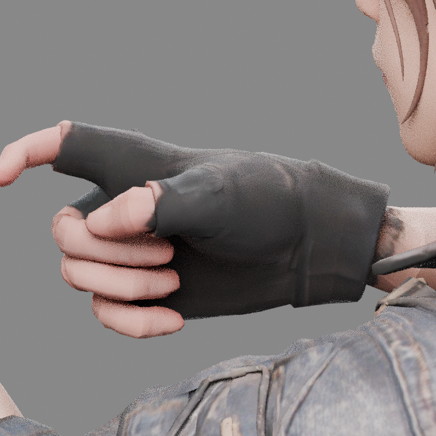

# 知更头部与两人手指修订

知更头部及发型等比放大 4%；嘴部相对脸宽收 8%，唇部高度轻收 5%。颈部衔接作渐变过渡，面部骨骼和马尾骨随模型适配。

默认待机改用 `woman_Standing Idle.fbx`，仍以 Idle 命名；上一段 `woman_idle.fbx` 保存为 WomanIdle。走路保持现版。

## 知更同姿态对照

两版使用相同站立待机帧与相同灯光、机位。

| 调整前 | 调整后 |
| --- | --- |
|  |  |
|  |  |

## 新增动作手指修复

原重定向遗漏手指第3节到指尖的方向补偿，使末节弯曲额外增加约70–100度。两人本轮新增动作已补齐这一段，并将第4节空指尖标记归零，使其跟随末节。第1、2节、手腕和原动作时序保留。

| 角色 | 修复前 | 修复后 |
| --- | --- | --- |
| 点点 |  |  |
| 知更 |  |  |

当前 GLB 与 Blender 完整文件均已包含本次修改。手指记录见各角色的 `finger_revision2.json`，头部比例记录见 `appearance_revision5.json`。
