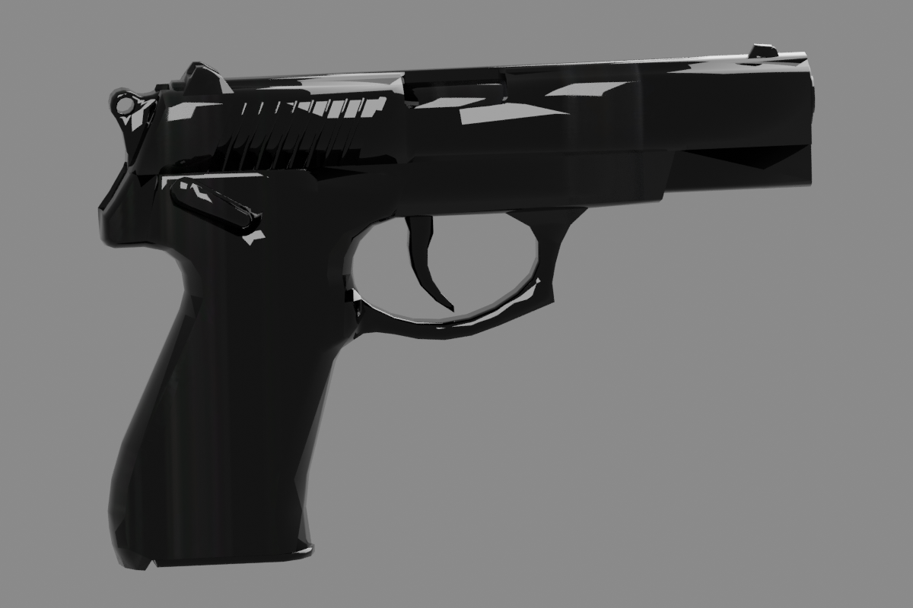
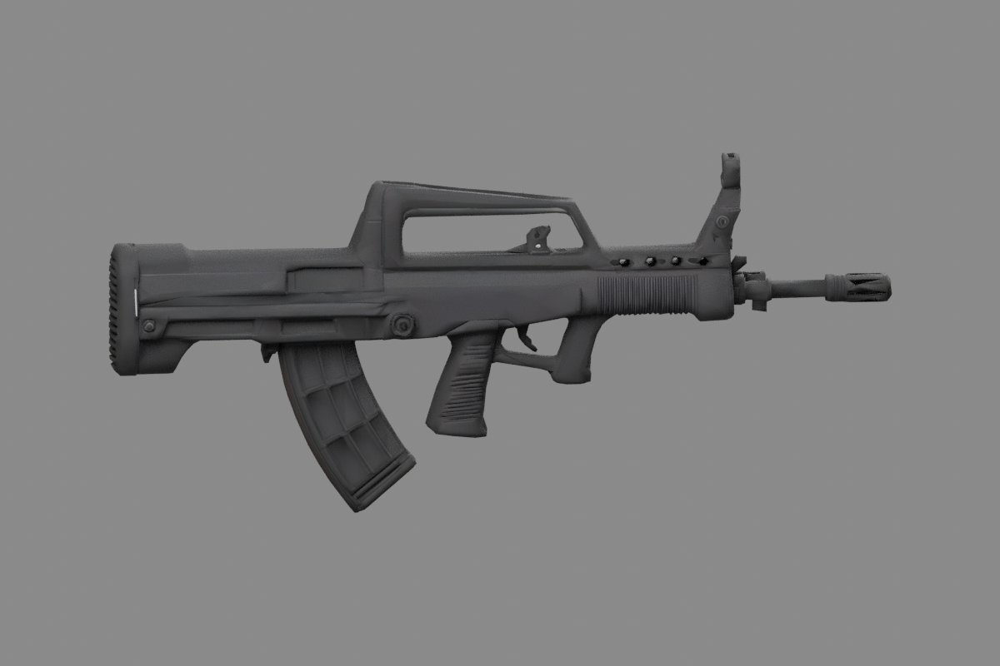
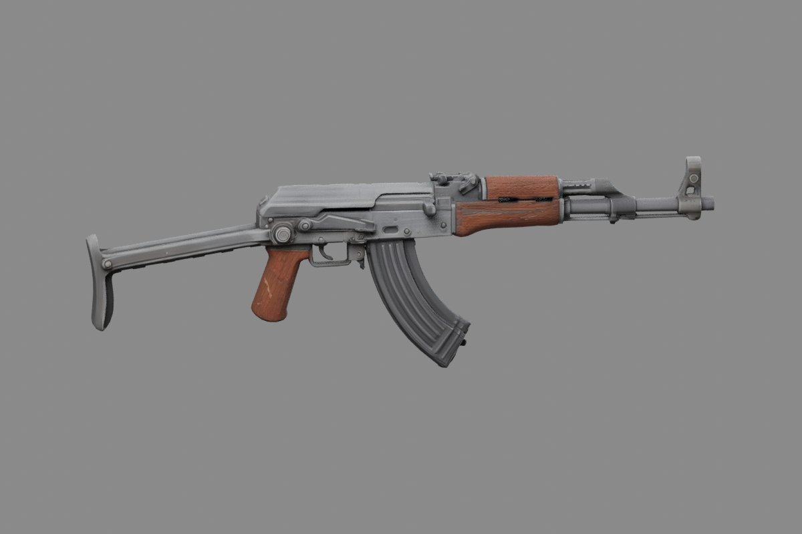
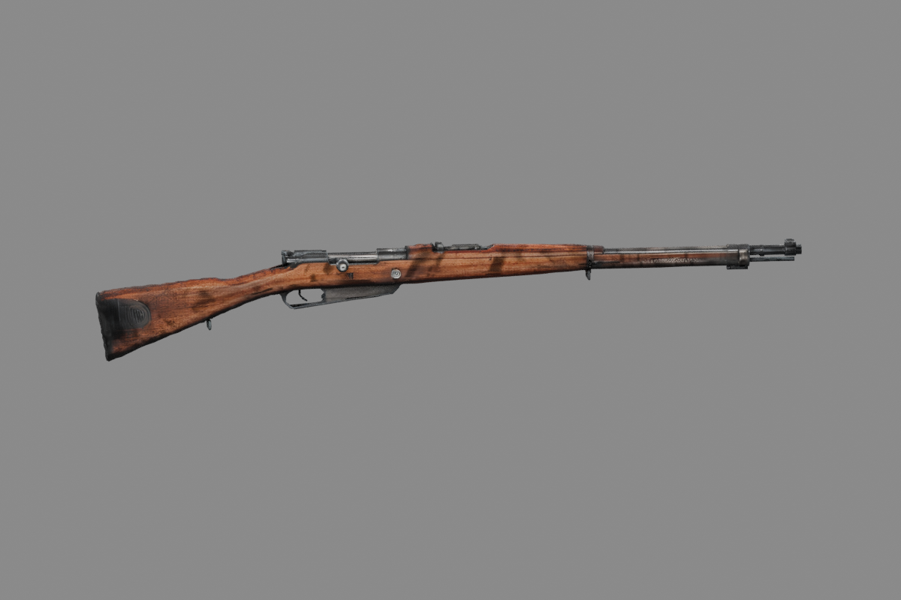
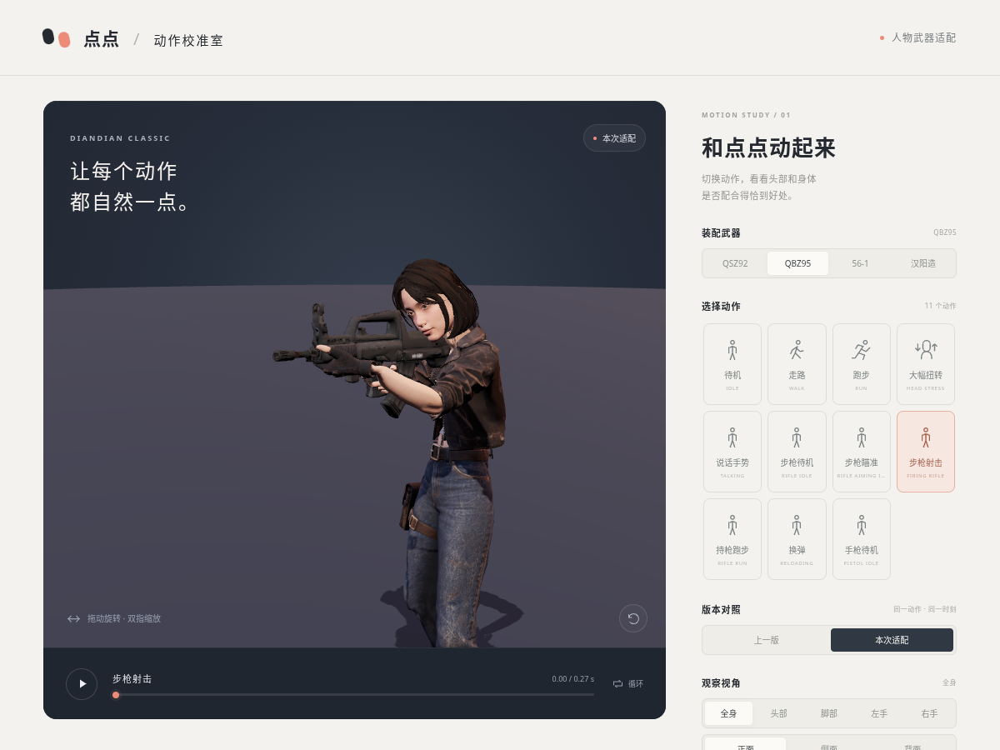
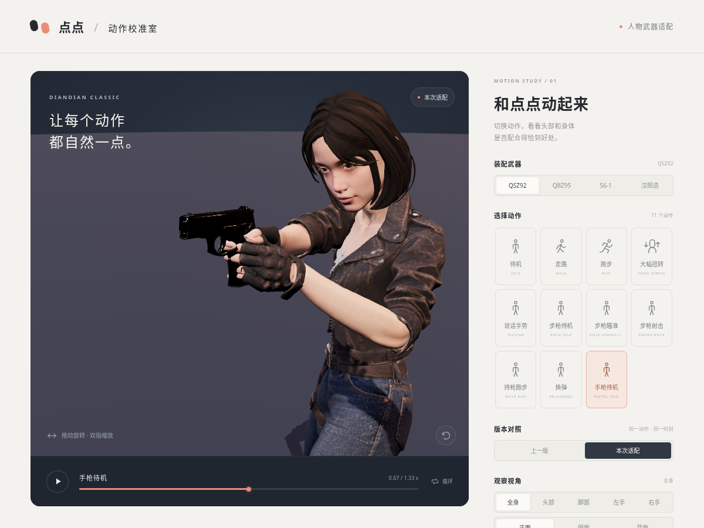
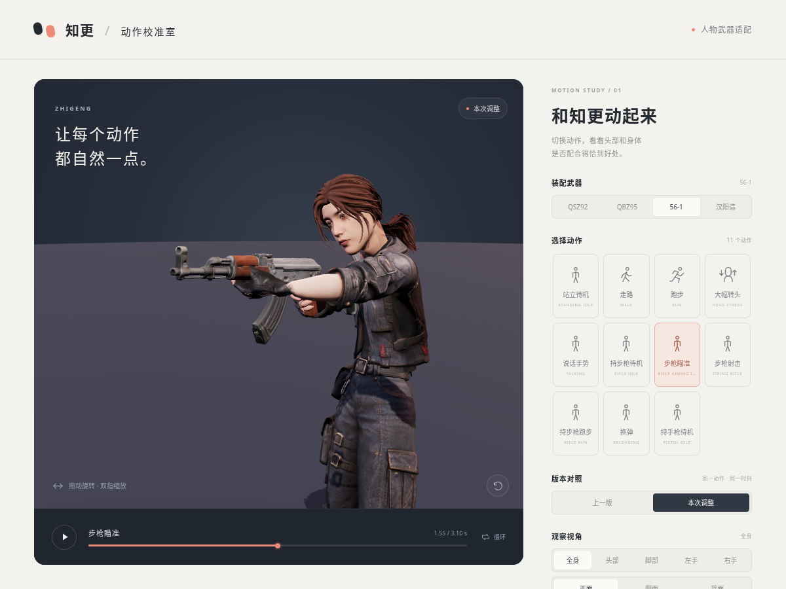
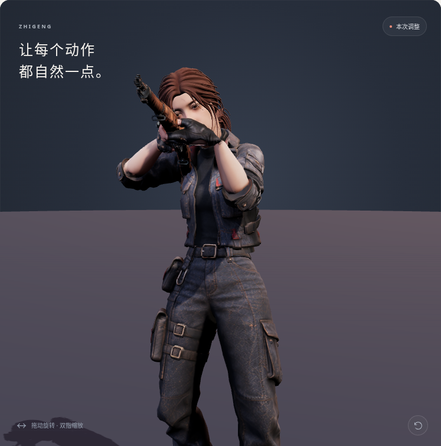

# 枪械模型

四件上传模型均保留原始外形比例、材质与 UV，按全长进行等比缩放。导出的 GLB 使用米为单位，Godot 中枪口朝 `-Z`、上方为 `+Y`，原点位于整体包围盒中心。

| 模型 | 全长 | 下载 | 预览 |
| --- | ---: | --- | --- |
| QSZ-92 | 190 mm | [qsz92.glb](qsz92.glb) | [预览](qsz92_preview.png) |
| QBZ-95 | 746 mm | [qbz95.glb](qbz95.glb) | [预览](qbz95_preview.png) |
| 56-1 | 870 mm | [type56_1.glb](type56_1.glb) | [预览](type56_1_preview.png) |
| 汉阳造 | 1250 mm | [hanyang88.glb](hanyang88.glb) | [预览](hanyang88_preview.png) |

上传的 `type56.glb` 已带有展开的金属下折式枪托，保留其形状并规范命名为 56-1。870 mm 为当前枪托展开状态的全长。

| QSZ-92 | QBZ-95 |
| --- | --- |
|  |  |
| **56-1** | **汉阳造** |
|  |  |

`source/` 归档原始上传文件，`source/sources.json` 记录 SHA-256；`dimensions.json` 记录缩放系数、统一坐标系与最终 GLB 重新导入后的尺寸。

四把枪已接入点点和知更的人物持枪预览。右手挂接握把，左臂跟随各枪护木支撑点；手枪使用双手握持，换弹时左手按原动作释放，普通待机与走跑隐藏武器。表中长度保留在源 GLB 中，人物预览按下表调整长枪显示比例。适配以原动作的自然姿态为主，肩膀纠正上限 8°，托枪手与指节只做适度混合修正，允许轻微穿模。

汉阳造使用角色原有的通用步枪动作组。修订8对待机、瞄准、射击、跑动和换弹增加专用握持：按模型蒙皮测得的真实掌心贴合枪托右侧表面，右臂双骨 IK 保持骨长，拇指与三根握持手指分别包住细枪托，食指平放枪侧、射击时再接近扳机。瞄准与射击按枪托中央尾面抵住右肩肩窝，再求解双臂，左肘不再近乎伸直。换弹保留左手释放；身体、腿部和原动作节奏沿用原片段。

共享适配数据在 `character_attachment.json`，包含每个角色、枪械与动作的掌心挂点、手腕朝向及握持指节参数。Godot 组件为 `godot/scripts/character_weapon_attachment.gd`；两个预览入口分别是 `godot/scenes/diandian_preview.tscn` 和 `godot/scenes/zhigeng_preview.tscn`。

[点点持枪预览](https://diandian-classic-motion-lab.expert-eagle-6942.chatgpt.site) · [知更持枪预览](https://zhigeng-motion-lab.expert-eagle-6942.chatgpt.site)

| 点点 · QBZ95 | 点点 · QSZ92 |
| --- | --- |
|  |  |
| **知更 · 56-1** | **知更 · 汉阳造** |
|  |  |

| 人物预览比例 | QBZ95 | 56-1 | 汉阳造 | QSZ92 |
| --- | ---: | ---: | ---: | ---: |
| 点点 | 96% | 93% | 88% | 100% |
| 知更 | 94% | 91% | 86% | 100% |

枪体与握把、护木、扳机挂点使用相同缩放。QBZ95、56-1 沿用原有右腕修正；汉阳造单独求解右臂和掌心旋转，换弹随原动作转枪。QSZ92 保留 190 mm，通过专用指节包握适配右手枪柄和左手支撑。

修订8同时用于两个网页与 Godot 预览；GLB 保存原始动画，逐枪握持约束由运行时组件应用。`hanyang_grip_revision8.json` 记录验证结果。

[点点汉阳造](character_previews/diandian_hanyang88.png) · [知更92式](character_previews/zhigeng_qsz92.png) · [点点56-1](character_previews/diandian_type56_1.png) · [知更95式](character_previews/zhigeng_qbz95.png)

修订9降低两人瞄准、射击时的右肘，并同步调整右腕方向，避免肘部过度上扬。待机和持枪跑步只修改右手食指，将末节上翘改为三节连续轻弯。以自然持枪为优先，允许轻微穿插。验证记录见 `hanyang_grip_revision9.json`。
